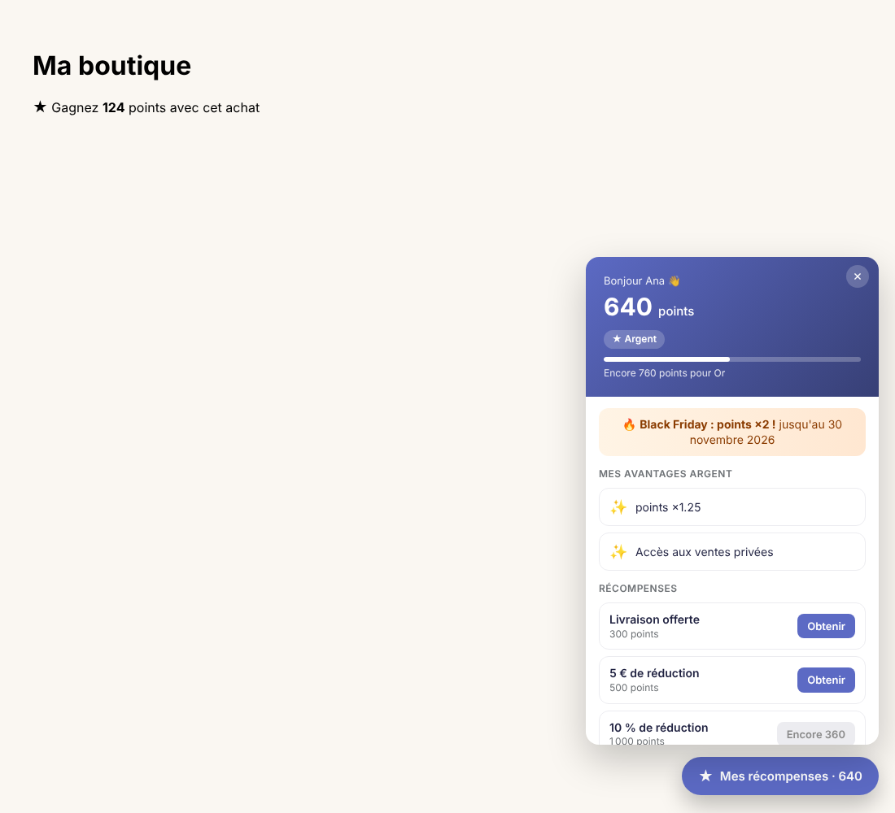
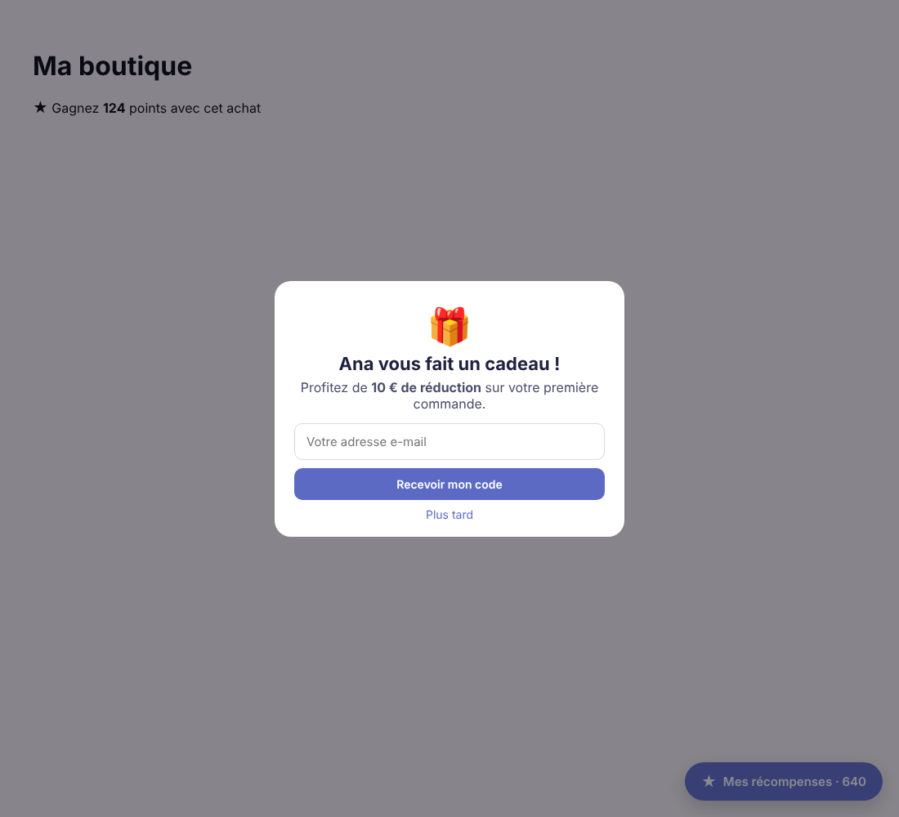

# Hoshi Fidélité – application Shopify de programme de fidélité

Application Shopify intégrée à l'administration permettant de lancer un
programme de fidélité complet en quelques minutes : points, niveaux clients
avec remises automatiques, récompenses, parrainage, anniversaire, réseaux
sociaux, campagnes de points bonus et widget sur la boutique.

| Widget client | Arrivée d'un ami parrainé |
| --- | --- |
|  |  |

## Fonctionnalités

**Pour le marchand (administration Shopify, Polaris)**

| Page | Rôle |
| --- | --- |
| Tableau de bord | Statistiques (membres, points distribués/échangés, récompenses), **CA généré par les récompenses et le parrainage**, graphique des points sur 30 jours, activité récente, liste « Bien démarrer » |
| Membres | **Ajouter un client** (recherche dans vos clients Shopify) en choisissant son niveau, import de tous les clients, filtre par niveau, fiche client : historique, ajustement du solde, **changement de niveau**, envoi d'une récompense, retrait du programme |
| Récompenses | Montant fixe, pourcentage ou livraison offerte ; coût en points, minimum de commande, masquer/afficher |
| Niveaux clients | Niveaux **automatiques** (selon les points cumulés) ou **manuels** (attribués par le marchand, ex. « Ambassadrice », « Pro »). Avantages par niveau : **remise permanente** (% ou montant, avec minimum d'achat), **livraison offerte**, multiplicateur de points, avantages libres affichés au client |
| Réglages | Points par euro, bonus de bienvenue et de 1re commande, **anniversaire**, **parrainage**, **réseaux sociaux**, **campagne de points bonus** (×1,5 / ×2 / ×3 avec dates), **expiration** des points inactifs, apparence du widget avec **aperçu en direct** |

Un programme prêt à l'emploi (3 niveaux, 3 récompenses) est créé à la première ouverture.

### Comment les remises de niveau s'appliquent

Les avantages d'un niveau sont appliqués **automatiquement au paiement**, sans code :

1. chaque niveau possède une étiquette client Shopify (ex. `Fidélité Or`), posée et retirée automatiquement sur les clients quand leur niveau change ;
2. si le niveau a une remise ou la livraison offerte, l'application crée un **segment de clients** « possède l'étiquette `Fidélité Or` » ;
3. des **remises automatiques** Shopify sont réservées à ce segment.

Les remises sont visibles (et modifiables) dans *Shopify > Réductions*. Elles se
cumulent avec les codes de récompense. Les étiquettes peuvent aussi servir à vos
campagnes e-mail ou à votre thème. Le bouton « Resynchroniser avec Shopify » de la
page Niveaux recrée tout en cas de modification manuelle.

### Toutes les façons de gagner des points

| Action | Fonctionnement |
| --- | --- |
| Inscription | Bonus de bienvenue |
| Achat | X points par euro × multiplicateur du niveau × campagne bonus en cours |
| 1re commande | Bonus supplémentaire |
| Anniversaire | Le client saisit sa date dans le widget ; points crédités le jour J (date à saisir au moins 30 jours avant, non modifiable, une fois par an) |
| Parrainage | Lien personnel `?parrain=CODE` ; l'ami saisit son e-mail et reçoit un code de bienvenue à usage unique ; le parrain est crédité quand ce code est utilisé dans une commande payée (un parrainage par e-mail, réservé aux nouveaux clients, auto-parrainage impossible) |
| Réseaux sociaux | Points pour suivre Instagram, Facebook, TikTok (une fois par réseau) |

**Pour les clients (extension de thème)**

- *Intégration d'application* « Fidélité Hoshi » : bouton flottant + panneau (solde, niveau et ses avantages, progression, récompenses, codes obtenus).
- *Bloc d'application* « Carte fidélité » à placer dans n'importe quelle page.
- *Bloc d'application* « Points produit » pour la fiche produit : « Gagnez 124 points avec cet achat » (tient compte du niveau du client et de la campagne bonus, suit le changement de variante).
- Fenêtre d'accueil pour les amis parrainés, bandeau de campagne bonus, date d'expiration des points.
- Échange en un clic : un code de réduction **personnel, à usage unique** est créé et peut être appliqué directement au panier.

**Automatique**

| Événement | Effet |
| --- | --- |
| `customers/create` | Création du membre + bonus de bienvenue |
| `orders/paid` | Points = sous-total × taux × multiplicateur du niveau (+ bonus 1re commande), puis mise à jour de l'étiquette de niveau |
| `refunds/create` | Retrait proportionnel des points (plafonné à ce que la commande a rapporté) |
| Webhooks RGPD | Export / suppression des données client et boutique |

Tous les webhooks sont idempotents : un webhook rejoué ne crédite jamais deux fois.

**Tâches périodiques** : toutes les heures, le serveur crédite les anniversaires du jour
et fait expirer les points des membres inactifs (si l'option est activée). Ces tâches sont
idempotentes ; définissez `DISABLE_JOBS=1` pour les désactiver sur une instance.

## Architecture

```
app/
  loyalty.server.ts        logique métier (points, niveaux, échanges, stats)
  levels.server.ts         synchro des niveaux avec Shopify (étiquettes, segments, remises automatiques)
  engagement.server.ts     parrainage, anniversaire, réseaux sociaux, expiration, suivi des codes
  jobs.server.ts           tâches périodiques
  routes/app.*.tsx         pages d'administration (Polaris web components)
  routes/webhooks.*.tsx    webhooks Shopify
  routes/proxy.$.tsx       API du widget via le proxy d'application (/apps/fidelite/loyalty)
extensions/loyalty-widget  extension de thème (Liquid + JS/CSS sans dépendance)
prisma/schema.prisma       Program, Member, Transaction, Reward, Tier, Redemption
```

Stack : React Router 7, `@shopify/shopify-app-react-router`, Polaris web components, Prisma (SQLite par défaut).

## Installation

Prérequis : Node.js ≥ 22.12, un [compte Partenaire Shopify](https://partners.shopify.com) et une boutique de développement.

```bash
cd shopify-loyalty
npm install
npm run config:link     # crée/associe l'application dans votre compte Partenaire
npm run dev             # lance l'app, le tunnel et l'extension de thème
```

Appuyez sur `p` pour ouvrir l'application dans votre boutique de test, puis :

1. Ouvrez **Réglages** pour ajuster le taux de points et la couleur.
2. Dans le tableau de bord, cliquez sur **Ouvrir l'éditeur de thème** et activez
   « Fidélité Hoshi » dans *Intégrations d'applications*.
3. Passez une commande test avec un compte client : les points apparaissent.

### Accès aux données client protégées

Les webhooks `orders/paid` et `customers/create` contiennent des données
personnelles. Dans le Partner Dashboard → *API access* → **Protected customer
data access**, demandez l'accès (nom, e-mail) avant de passer en production.
En développement sur une boutique de test, l'accès de niveau 1 suffit.

## Mise en production

1. Hébergez l'app (Fly.io, Render, Railway, Google Cloud Run…) avec le `Dockerfile` fourni.
2. Pour plusieurs instances, passez Prisma sur PostgreSQL ou MySQL (`prisma/schema.prisma`, `provider`), puis régénérez la migration.
3. Variables d'environnement : `SHOPIFY_API_KEY`, `SHOPIFY_API_SECRET`, `SHOPIFY_APP_URL`, `SCOPES=write_customers,read_orders,write_discounts`.
4. Mettez à jour `application_url`, `redirect_urls` et `app_proxy.url` dans `shopify.app.toml`, puis `npm run deploy`.

## Commandes utiles

| Commande | Description |
| --- | --- |
| `npm run dev` | Développement avec la CLI Shopify |
| `npm run build` | Build de production |
| `npm run typecheck` | Vérification TypeScript |
| `npm run deploy` | Publie la configuration et l'extension de thème |
| `npx prisma studio` | Explorer la base de données |
